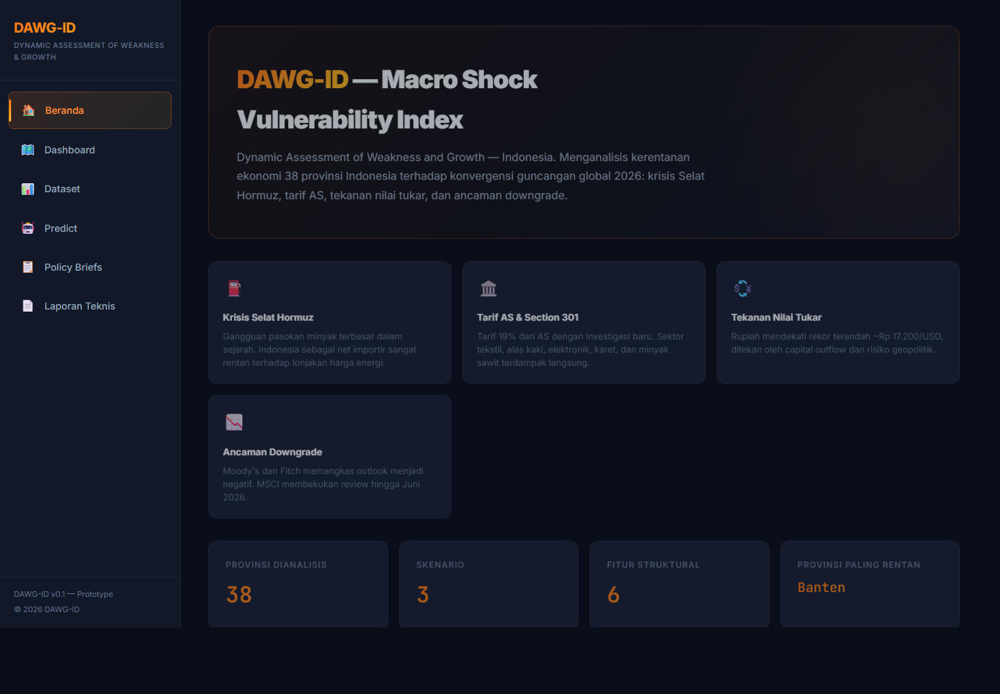
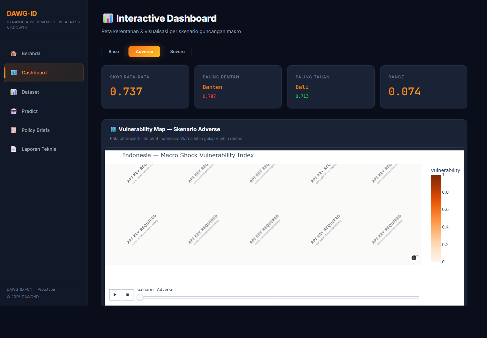
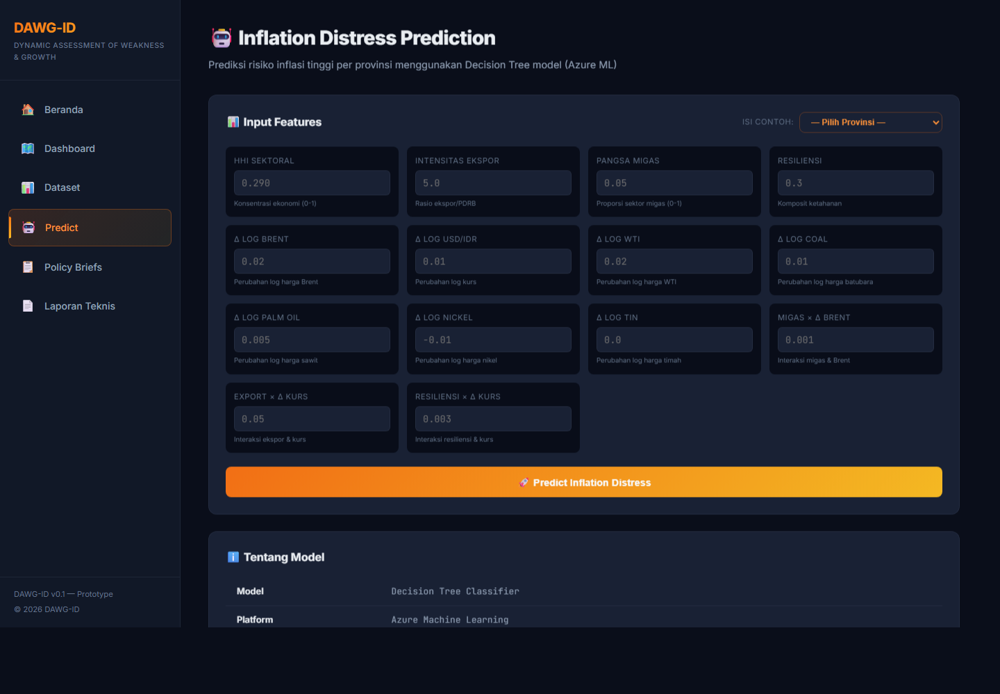

# DAWG-ID Portal

**Dynamic Assessment of Weakness and Growth — Indonesia (DAWG-ID)**

Aplikasi web portal interaktif untuk memvisualisasikan Macro Shock Vulnerability Index dari 38 provinsi di Indonesia terhadap konvergensi guncangan global tahun 2026.

Portal ini menyatukan deliverables proyek termasuk:
- Interactive Dashboard (Peta Choropleth & Statistik)
- Vulnerability Index Dataset
- AI-Generated Policy Briefs (Tahap Pengembangan)
- Laporan Teknis Metodologi

## Live portal

Portal yang di-deploy tersedia di: https://akarandy.github.io/DAWG-ID/

## Screenshots

### Home (`/#/`)


_Landing page dengan deskripsi skenario guncangan makro 2026, kartu ringkasan (38 provinsi, 3 skenario), tabel Top 10 provinsi paling rentan, dan tabel parameter skenario._

### Dashboard (`/#/dashboard`)


_Halaman Interactive Dashboard dengan pemilih skenario (Base/Adverse/Severe), kartu statistik, peta choropleth kerentanan Indonesia, dan tabel peringkat Top 10 provinsi._

### Predict (`/#/predict`)


_Halaman Inflation Distress Prediction dengan formulir input fitur (pemilih provinsi dan parameter skenario) serta kartu informasi metrik model Decision Tree._

## 🚀 Prasyarat Sistem

Sebelum menjalankan aplikasi ini, pastikan sistem Anda telah menginstal:
- **Node.js** (Versi 20.x atau yang direkomendasikan)
- **NPM** (Biasanya sudah terpasang bersama Node.js)

## 🛠️ Cara Instalasi

1. Buka terminal atau command prompt.
2. Arahkan direktori (cd) ke folder `dawg-id-portal`.
   ```bash
   cd "c:\Users\LENOVO\Downloads\project_hormuz\project hormuz\dawg-id-portal"
   ```
3. Install semua dependensi yang dibutuhkan:
   ```bash
   npm install
   ```

## ▶️ Cara Menjalankan Aplikasi

1. Setelah instalasi selesai, jalankan perintah berikut di terminal:
   ```bash
   npm run dev
   ```
2. Terminal akan menampilkan URL lokal (biasanya `http://localhost:5173/`).
3. Buka URL tersebut di browser web Anda (Chrome/Firefox/Edge) untuk melihat aplikasi.

## 🛑 Cara Menghentikan Aplikasi

- Pada terminal yang sedang menjalankan aplikasi, tekan **`Ctrl + C`**.
- Jika ditanya `Terminate batch job (Y/N)?`, ketik `Y` lalu tekan Enter.

## 📂 Struktur Folder Utama

- `src/` - Berisi semua kode sumber (React components, routing, dll)
  - `pages/` - Halaman utama (Home, Dashboard, Dataset, PolicyBriefs, Report)
  - `data/` - Dataset vulnerability index yang sudah di-compile
  - `index.css` - Styling aplikasi (Dark Analytics Theme)
- `public/` - Aset statis yang dapat diakses langsung (GeoJSON map, peta HTML)
- `package.json` - Konfigurasi project dan dependensi (Vite + React)
